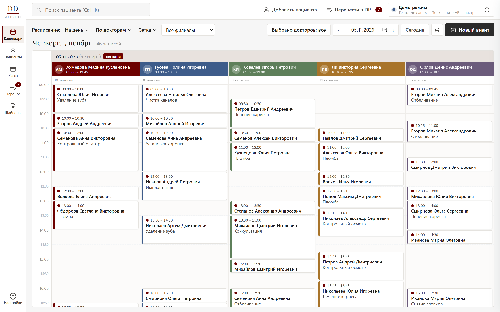
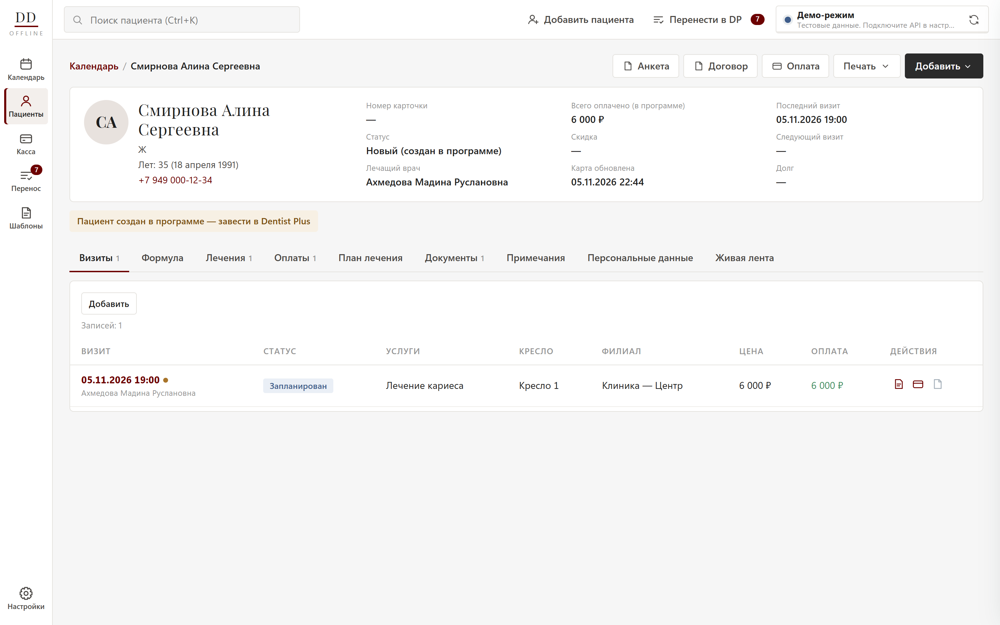
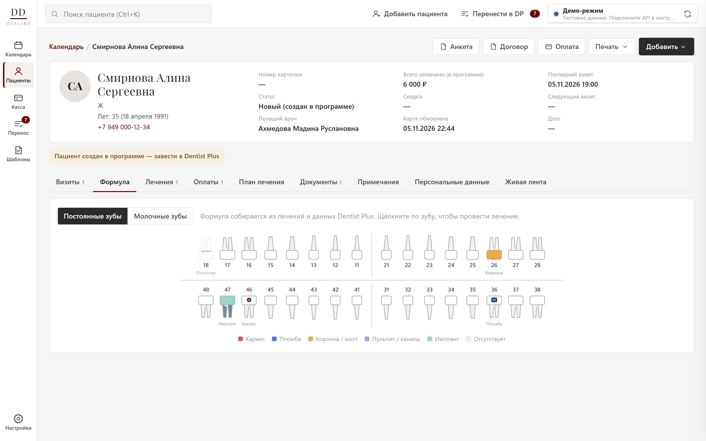
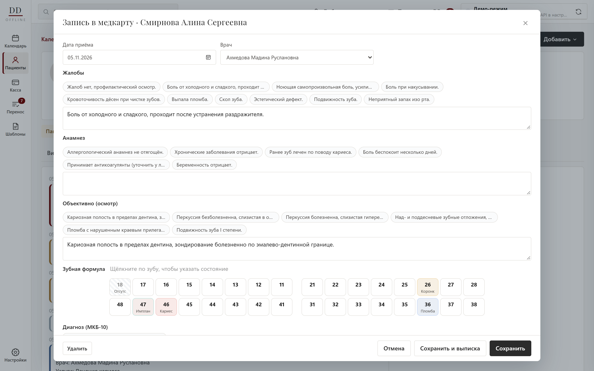
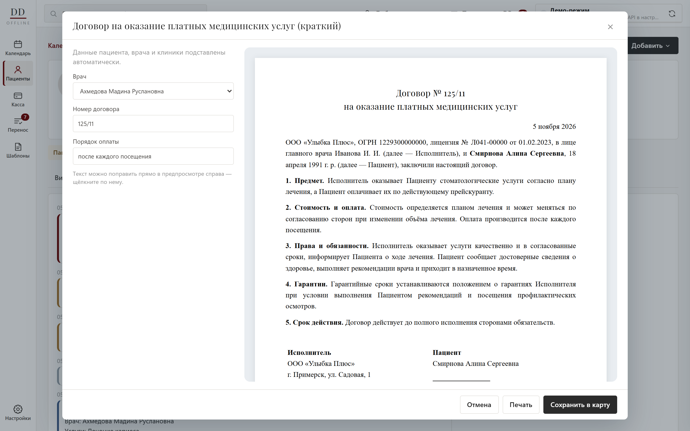
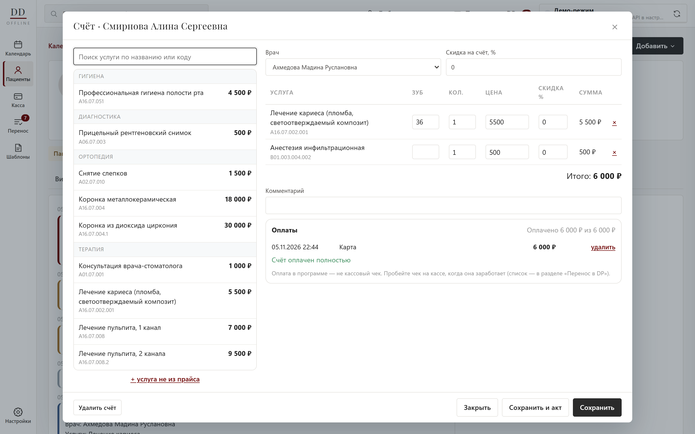
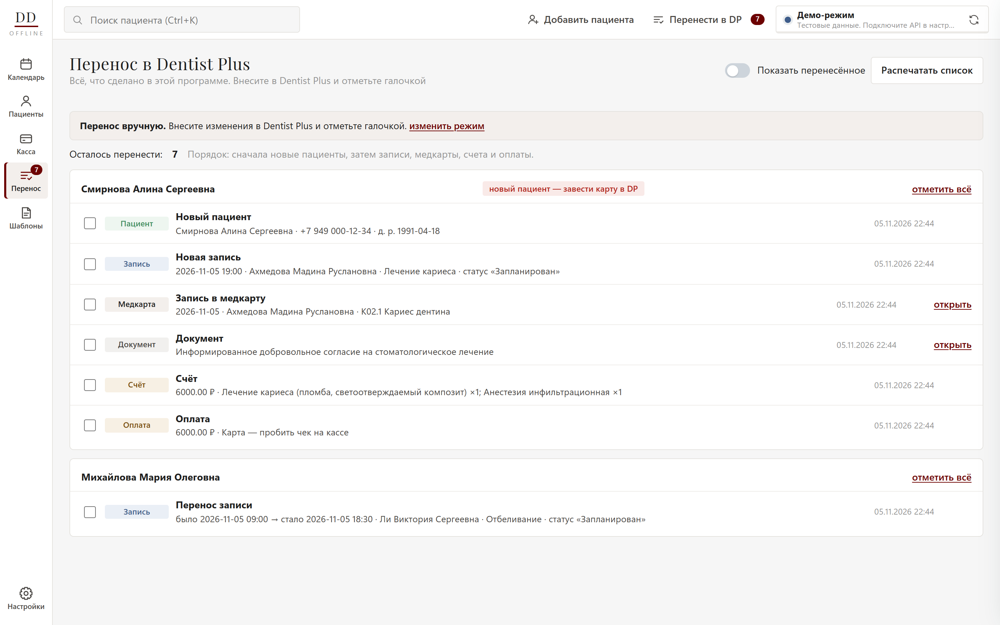

# Dental Desk — offline shell for Dentist Plus

A Windows desktop app that keeps a dental clinic working when the internet or the power goes down —
an offline shell over the clinic's cloud system, **Dentist Plus**.

Built for a private dental clinic that loses electricity and connectivity several times a month.
One `.exe`, installs itself, no admin rights, no server.



---

## The problem

The clinic runs everything in Dentist Plus, a cloud MIS: schedule, patient cards, documents, payments.
When the connection drops, the whole front desk stops. Nobody can see who is booked to which doctor,
open a patient's allergy list, or print a consent form — while patients are already in the chair.

Paper backups go stale within a day. Exports are manual and nobody remembers to make them.

## The solution

A local app on the reception laptop that silently mirrors Dentist Plus every five minutes and keeps
working without it.

- **While online** it pulls the schedule (30 days back, 30 ahead), doctors, branches and full patient
  cards through the Dentist Plus partner API into a local database.
- **While offline** staff work as usual: book and move appointments, fill in the medical record,
  print contracts and consent forms, take payments. The top bar shows how fresh the data is.
- **When the link is back** it syncs again within 30 seconds, and everything done offline is waiting
  in one checklist — or is sent to Dentist Plus automatically, if the clinic switches that on.

## What's inside

| | |
|---|---|
| **Calendar** | Day / 2 days / week, by doctor or by chair, doctor filter, click an empty slot to book, drag a visit to another time, doctor or day, recurring visits (weekly to monthly, cancel the rest of a series), overlap warnings, print the day |
| **Waiting list** | Patients who want an earlier or a specific time, with a count above the calendar and a hint when a visit of that doctor is cancelled |
| **Visit reminders** | One click opens WhatsApp with a ready reminder text (name, date, time, doctor, clinic) or copies it for Telegram; editable template; sent reminders are marked for the whole team |
| **Patient card** | Visits, dental formula (permanent and milk teeth), treatments, payments, treatment plans, documents, notes, full history feed |
| **Medical record** | Complaints, anamnesis, examination, treatment with one-click phrase templates, ICD-10 dental codes, interactive tooth chart |
| **X-rays and files** | X-rays (DICOM included, windowing and MONOCHROME1 handled), photos, scans and PDFs in the patient card; add by button, drag & drop, Ctrl+V or from the visiograph's export folder; viewer with zoom, pan, brightness, contrast, invert, rotate and a before/after split comparison; files mirrored to the backup flash drive |
| **Periodontal chart** | Pocket depth, recession, bleeding, mobility and furcation for 32 teeth; fast keyboard entry, voice entry ("tooth sixteen, three two four, bleeding, palatal…"), colour-coded depths, mean depth / CAL / % ≥ 4 mm / BOP and the change since the previous chart |
| **Allergy check** | The patient's allergies (card and anamnesis) against the treatment, recommendations and billed services: same substance is a stop, same group (e.g. amide anaesthetics, penicillins) is a warning |
| **Documents** | 11 templates (consents, contract, plan, act, extract, form 043/u, receipt) filled from patient, doctor, clinic and invoice data; edit in preview, print or save as PDF |
| **Signatures** | Documents signed with a mouse, pen or finger on this screen or on the patient tablet; signer, time, place and a hash of the text are kept, an edit after signing is flagged, signatures print under the document |
| **Patient tablet** | Any tablet browser on the clinic Wi-Fi, paired once with a 6-digit code (no login); staff send a document or the questionnaire from the card and see "done" when the patient signs; the tablet key opens only its own task |
| **Health questionnaire** | Yes/no questions with details, signed by the patient; saved as a signed document, key answers shown on the card, allergies fed into the allergy check |
| **Tax deduction certificate** | Certificate of paid medical services for the tax office: year totals from payments, payer other than the patient, numbering per year, saved to the card, yearly register |
| **Excel export** | Report, accounting, call-list and sterilization tables saved as .xlsx with numbers kept as numbers (built without extra libraries) |
| **Money** | Invoices from the price list with per-line discounts, partial payments, staged treatment plans billed step by step, daily cash report |
| **Dental lab orders** | Work orders with teeth, shade, fitting and due dates, statuses and the lab's price; overdue highlighted, printable order form, paying a lab records an expense, lab cost can be subtracted from a doctor's pay, orders visible in treatment plans |
| **Certificates, bonuses, families** | Gift certificates sold at the cash desk and redeemed by code with a remaining balance; bonus points as a percent of money payments with a cap per invoice; families share bonuses and get a discount offered in every invoice; deleting a payment gives everything back |
| **SBP and terminal** | The clinic's static SBP QR code with the amount on screen or on the patient tablet; an optional terminal operation number on card payments; the day's cash counts real money only |
| **Transfer to Dentist Plus** | A checklist of everything created offline — or automatic sending of new patients and appointments |
| **Dictation** | The doctor dictates the visit; speech is recognized on the laptop (Whisper, no internet), split into record fields, ICD-10 codes and tooth states by offline rules, optionally tidied by any OpenAI-compatible model with the patient's name and phone removed |
| **Double bookings** | Overlaps between laptops that worked offline are flagged in the calendar and the transfer list, and are not sent to Dentist Plus until resolved |
| **Fiscal receipts** | 54-FZ receipts on ATOL (DTO 10 web server) or Shtrih-M (COM driver) registers, or a test mode: receipt on payment, partial payment and credit rules, returns, shifts, X/Z reports, failed receipts kept for retry |
| **Stock** | Materials with minimum levels, supplier invoices, write-offs with a printed act, stock counts, consumption norms per service — billing a service writes its materials off automatically |
| **Expiry dates and lots** | Lot number and expiry date on every receipt line; lots on hand worked out from the move ledger first-expired-first-out (nothing stored, so edited invoices never break them); expired and soon-to-expire materials highlighted with a filter and a counter on the menu badge; one-click write-off of everything expired |
| **Purchase list** | One button: everything below the minimum or lasting under 14 days, quantity from the last 60 days' use to cover 30 days, the cheapest supplier by last purchase price with the other offers alongside, grouped by supplier with a printed request, Excel and a pre-filled receipt |
| **Barcode scanner** | Keyboard-mode USB scanners in the receipt form: a known code adds a line or +1, an unknown one offers to create the material; GS1 / «Честный знак» DataMatrix codes fill the lot and expiry date |
| **Equipment** | Register with inventory numbers, location, warranty and service dates, service history, write-off with a commission and a printed act |
| **Sterilization journal** | Autoclave and dry-heat cycles with mode, chemical and biological indicators, load and operator; cycle numbers per sterilizer and year, failed cycles flagged, printable for inspections |
| **Clinic network** | One computer is the server; reception, surgeries and the director's PC connect over the local network and find it automatically |
| **Staff accounts** | Self-registration, director approval, password sign-in, roles (director, administrator, doctor, assistant) with per-person permission overrides, action journal |
| **Backups** | A verified, compressed copy of the whole database at start, every 2 hours and on exit, made with SQLite's online backup while the app keeps working; rotation (everything for 2 days, one per day for 30); an optional second folder on a flash drive; one-click restore that first saves the current data and then restarts the app |
| **Disk encryption check** | Settings show whether the drive with the database is protected by BitLocker / Device Encryption (read without admin rights) and how to turn it on |

| Patient card | Dental formula |
|---|---|
|  |  |

| Medical record | Document from a template |
|---|---|
|  |  |

| Invoice | Transfer checklist |
|---|---|
|  |  |

## Three decisions worth explaining

**A tolerant reader instead of a fixed schema.** The partner API documents only its login endpoint.
Rather than guess one format and break on the first real response, every field is read through a list
of candidate names and formats — `start`, `date` + `time`, ISO with a timezone, Unix seconds,
`dd.mm.yyyy`; patient as an id or a nested object; doctor as an object or a list. The raw JSON is
always stored too, so nothing is lost, and a built-in **API diagnostics** screen shows real responses
so the mapping can be tuned without a rebuild. The sync is tested against four differently shaped fake
servers.

**Writes that can't create duplicates.** Automatic sending to the clinic's live system is the riskiest
part, so it follows strict rules: an item counts as sent only on a 2xx answer; a write that timed out
is never retried automatically (status "check by hand"); before creating a visit the app looks for the
same visit in Dentist Plus; after creating it re-reads the day and compares time and doctor. Endpoint
paths and field names live in settings, so they can be corrected on site. Medical records, documents
and payments stay manual — payments need a fiscal receipt anyway.

**Local edits as an overlay, not a fork.** Offline changes never touch the synced tables. A moved
appointment is a local row that hides the synced one; the calendar is a `UNION` of both. When the next
sync brings the change back from Dentist Plus, the overlay disappears on its own and a temporary patient
card is merged into the real one. Sync can replace its data at any time without losing anything typed
by staff.

## Clinic network and staff accounts

Version 2.0 turns the single-laptop app into a small clinic system without adding any infrastructure.
The same `.exe` asks on first start whether this computer is the **server** or should **connect to
one**. The server keeps the database and the Dentist Plus sync and serves the UI over HTTP; other
computers find it with a UDP broadcast and open it in their own window. If the router hands out a new
address, clients find the same server again by its id.

Every request carries a session token and is checked on the server against the employee's
permissions, so a hidden button is never the only protection. A new employee registers, the director
approves the request and picks a role; any role can be fine-tuned per person. Passwords are PBKDF2
hashes, only token hashes are stored, repeated wrong passwords are throttled, blocking an employee ends
their sessions at once, and the last director cannot be demoted. Bookings, payments, treatments,
permission edits and sign-ins land in an action journal with the employee's name.

The same server is ready to move to a hosted machine later: the UI already talks to it only over HTTP.

## Architecture

```
Dentist Plus partner API
        │  every 5 min while online (7-day chunks, paged, retries with Retry-After)
        ▼
  sync.py ── api_client.py ── normalize.py (tolerant field reader)
        │                         pusher.py (optional automatic sending)
        ▼
  SQLite (WAL, one transaction per chunk — safe on power loss)
        ▲
  server.py  HTTP API + UI files · auth.py (accounts, roles, sessions, journal) · UDP discovery
        ▲  clinic LAN
  main.py on every computer (pywebview window, server or client)
        ▲
  ui/  plain HTML/CSS/JS, no framework, works fully offline (fonts bundled)
```

| File | Role |
|---|---|
| `app/main.py` | Window, server/client start, data API, autostart |
| `app/installer.py` | Install and update the program folder for the current user: close the running copy, swap folders safely, shortcuts |
| `app/setup_main.py` | The shipped `.exe`: a small installer carrying the program folder as a zip |
| `app/server.py` | Clinic server: HTTP API, permission checks, UI files, network discovery |
| `app/auth.py` | Staff accounts, password hashing, sessions, roles and permissions, action journal |
| `app/speech.py` | Offline speech recognition: model download, transcription |
| `app/dictation.py` | Dictated protocol → record fields, ICD-10, tooth states |
| `app/ai.py` | Optional language-model layer (OpenAI-compatible), anonymization, validation |
| `app/conflicts.py` | Double-booking detection |
| `app/fiscal.py` | Fiscal receipts: receipt rules, test mode, ATOL web server and Shtrih-M drivers, shifts, returns |
| `app/stock.py` | Materials as a ledger of moves, receipts, write-offs, stock counts, service norms, lots and expiry (FEFO), purchase list, barcode parsing (GS1), equipment register |
| `app/ui/stock-lots.js` | Lots in the material card, expired write-off, purchase list window and supplier requests |
| `app/backup.py` | Automatic backups: online copy, integrity check, rotation, second folder, restore with a safety copy |
| `app/security.py` | Disk encryption state (BitLocker / Device Encryption) without admin rights |
| `app/waitlist.py` | Waiting list: entries, filters by doctor and day, booked / removed |
| `app/files.py` | Patient files: storage, previews (Pillow, pydicom), visiograph folder import, mirror for backups |
| `app/perio.py` | Periodontal chart: validation, statistics, voice commands |
| `app/allergy.py` | Allergy rules: substances, groups, allergies from the card and anamnesis |
| `app/sterilization.py` | Sterilization journal |
| `app/forms.py` | Signatures and the health questionnaire |
| `app/tablet.py` | Patient tablet: pairing codes, device keys, tasks, throttling |
| `app/taxcert.py` | Tax deduction certificates and their register |
| `app/xlsx.py` | Minimal .xlsx writer |
| `app/lab.py` | Dental lab orders, labs, paying labs |
| `app/loyalty.py` | Gift certificates, bonus points, families |
| `app/config.py` | Paths, settings, DPAPI password protection, clinic branding |
| `app/sync.py` | Background worker: online check, pull, purge, push, offline mode |
| `app/api_client.py` | Partner API client: auth, paging in any shape, retries, writes |
| `app/normalize.py` | Field extraction across naming and date formats |
| `app/db.py` | Schema, migrations, combined synced + local views |
| `app/local.py` | Everything created in the app: visits, records, documents, invoices, payments, transfer journal |
| `app/pusher.py` | Automatic sending to Dentist Plus with dedupe and verification |
| `app/catalog.py` | ICD-10 dental codes, phrase and document templates |
| `app/demo.py` | Invented demo clinic for showing the app without an account |

## Details that were harder than they looked

- **Power cuts mid-sync.** Visits are replaced one 7-day chunk per transaction with SQLite in WAL and
  `synchronous=FULL`; a cut leaves the previous data intact.
- **Endpoints that ignore filters.** If the server returns visits outside the requested dates, or
  ignores `?page`, the client notices and stops instead of looping.
- **One bad record.** A 500 on a single patient card used to stall the sync for over a minute; now two
  short retries and the sync moves on, counting the error.
- **Shipping to a non-technical client.** The `.exe` installs itself to the user profile on first run,
  creates desktop and Start menu shortcuts, and running a newer `.exe` updates it in place.
- **Start time.** A single-file PyInstaller build unpacked ~300 MB (speech recognition, ONNX, WebView2 bridge)
  into a temp folder on every start, and the antivirus re-scanned it each time. The shipped `.exe` is now a small
  installer that puts a folder build in place once; the program then starts with nothing to unpack (3.2 s → 1.1 s
  to a ready server on the test laptop; more on slower disks). The start-up backup and the first sync wait until the window is up.
- **Secrets.** The API password is encrypted with Windows DPAPI and only decrypts under the same
  Windows account.

## Stack

Python 3.11 · pywebview (Edge WebView2) · SQLite · requests · faster-whisper · vanilla HTML/CSS/JS ·
PyInstaller (single-file exe) · Playwright for screenshots

No web framework and no cloud: the server is the standard-library HTTP server on a clinic computer,
and the only internet calls go to Dentist Plus.

## Running it

```powershell
python -m venv .venv
.venv\Scripts\pip install -r requirements.txt
.venv\Scripts\python app\main.py          # desktop window, demo data
.venv\Scripts\python app\devserver.py     # same UI in a browser at http://127.0.0.1:8765
powershell -File build.ps1                # release\DentalDesk-<version>.exe, older builds move to release\old\
```

The app starts in demo mode with an invented clinic.

**Branding.** The public build is called *Dental Desk*. A clinic build puts its own name, mark,
icon and data folder into `app/brand.json` (kept out of the repository):

```json
{"name": "My Clinic", "short": "MC", "sub": "clinic", "exe": "MyClinic", "folder": "MyClinic"}
```

To connect a real account: Settings → untick demo mode → partner API login and password →
*Check connection* → *Save and sync*.

## Tests

```powershell
.venv\Scripts\python tests\test_api_all_functions.py     # 112 checks over every app function
.venv\Scripts\python tests\test_push_to_dentist_plus.py  # automatic sending against a fake API
.venv\Scripts\python tests\test_sync_api_formats.py      # sync against 4 differently shaped APIs
.venv\Scripts\python tests\test_server_auth.py           # 45 checks: accounts, approval, permissions over HTTP
.venv\Scripts\python tests\test_stock.py                 # 54 checks: stock, automatic write-off, equipment, rights
.venv\Scripts\python tests\test_fiscal.py                # 48 checks: receipt rules, test mode, fake ATOL server, fake Shtrih-M driver
.venv\Scripts\python tests\test_offline_copy.py          # 21 checks: encrypted read-only copy for laptops
.venv\Scripts\python tests\test_double_booking.py        # 18 checks: overlap rules, calendar flags, blocked sending
.venv\Scripts\python tests\test_dictation.py             # 25 checks: parsing rules, AI layer vs a fake server, real recognition if a model is present
.venv\Scripts\python tests\test_backup.py               # 56 checks: copy and check, rotation, missing flash drive, restore round-trip
.venv\Scripts\python tests\test_schedule_tools.py       # 64 checks: drag-move, recurring visits, waiting list, reminders, disk encryption
.venv\Scripts\python tests\test_medcard_tools.py        # 105 checks: allergy rules, sterilization, periodontal chart and voice, files, DICOM, visiograph folder
.venv\Scripts\python tests\test_documents_tools.py      # 92 checks: signatures, questionnaire, tablet over HTTP, tax certificate, Excel
.venv\Scripts\python tests\test_money_tools.py          # 107 checks: lab orders and payroll, certificates, bonuses, families, SBP, fiscal rules
.venv\Scripts\python tests\test_stock_lots.py           # 55 checks: FEFO lots, expiry, expired write-off, purchase list, cheapest supplier, barcode scanner, rights
.venv\Scripts\python tests\test_installer.py            # 15 checks: folder install, in-place update, broken installer, leftovers, data folder untouched
```

Cover booking, moving and cancelling, medical records, documents, invoices and partial payments,
treatment plans, CSV price import (including Windows-1251 files from Excel), the transfer journal,
settings, dedupe and validation errors on write, paging variants, timezones and partial server failures.

## Status and privacy

Version 2.0: clinic network, staff accounts, stock and equipment, fiscal receipts. All screenshots use an invented demo clinic — no real patient
appears anywhere in this repository. The app stores medical data locally only; the clinic is advised
to use Windows login and BitLocker.

Document templates are generic drafts written for this project and are meant to be reviewed by the
clinic's lawyer.

## License

Code — MIT. Bundled font Playfair Display SC — SIL Open Font License 1.1 (`app/ui/fonts/OFL.txt`).
